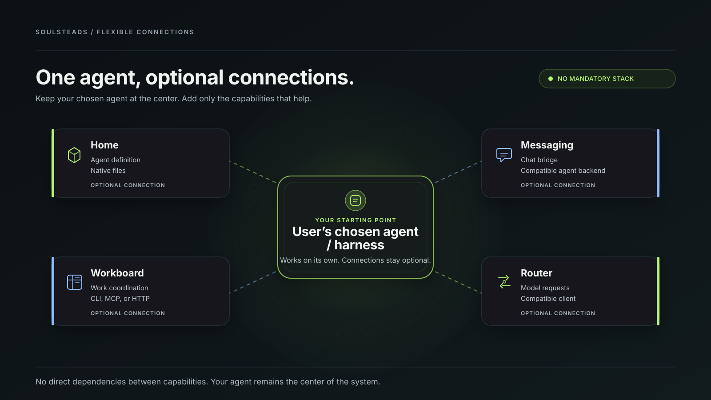

# Soulsteads

**Open-source tools for running AI agents on your own infrastructure.**

Keep the coding agent you already use. Pick a tool for portable configuration, chat access, shared work, or model routing. Each installs separately; there is no suite installer.

<!-- readme-start-here -->
## Start here

Choose one independent path. The links open component-owned guides; setup commands stay with those components. Tagged sources are source-only, and source previews are pinned to reviewed commits. These are not binary downloads.

### Start with a ready local Workboard

Create a useful local board using SQLite. No model or remote database is needed for this ready-to-use path.

**Agent Workboard — Tagged source v0.1.0 (source-only, not a binary download).** [Workboard quickstart](https://github.com/soulsteads/soulsteads-agent-workboard/blob/v0.1.0/README.md#quickstart)

### Connect Telegram to an existing agent

Follow the documented Telegram path using the existing coding-agent harness. This connector path adds no agent runner or model setup.

**Agent Messaging — Tagged source v0.2.0 (source-only, not a binary download).** [Telegram setup guide](https://github.com/soulsteads/soulsteads-agent-messaging/blob/v0.2.0/README.md)

### Try a no-model Forge workflow with dedicated PostgreSQL

Use Forge's documented no-model example with its own PostgreSQL database, separate from production. Follow the component guide for the supported setup.

**Agent Forge — Source preview (main at reviewed commit 9bcc307946730ac5c00c1a5552790504ba2fea4a).** [Forge source preview guide](https://github.com/soulsteads/soulsteads-agent-forge/blob/9bcc307946730ac5c00c1a5552790504ba2fea4a/README.md)

### Inspect a read-only Hermes import

Review a Hermes import in Home's default read-only inspection mode before deciding whether to apply it. The source stays unchanged during inspection; use the component guide for supported inputs and boundaries.

**Agent Home — Source preview (main at reviewed commit 31d1fc26fe210d82fd414780a4aeae78efea185f).** [Hermes import guide](https://github.com/soulsteads/soulsteads-agent-home/blob/31d1fc26fe210d82fd414780a4aeae78efea185f/docs/hermes-import.md)

<!-- end-readme-start-here -->
<!-- readme-lineup -->

## Released on GitHub

These are early, **source-only releases**: no prebuilt binaries. Check out the tag before following its setup guide; the guides and features on `main` can differ.

| Tool | Release | Use it to | What you need / setup |
| --- | --- | --- | --- |
| **Agent Home** | [v0.1.0](https://github.com/soulsteads/soulsteads-agent-home/releases/tag/v0.1.0) | Keep one agent’s instructions, skills, and configuration in a portable, Git-tracked home. | Python 3.11+, Git, and a supported agent runtime to launch it. [Setup at v0.1.0](https://github.com/soulsteads/soulsteads-agent-home/blob/v0.1.0/README.md#other-installation-options) |
| **Agent Messaging** | [v0.2.0](https://github.com/soulsteads/soulsteads-agent-messaging/releases/tag/v0.2.0) | Talk to an existing coding agent from chat or the built-in web interface. | Rust/Cargo, Git, an authenticated coding agent, and connector credentials as needed. Set a nonempty sender allowlist (`allowedUsers`) before enabling a remote connector. [Setup at v0.2.0](https://github.com/soulsteads/soulsteads-agent-messaging/blob/v0.2.0/docs/SETUP.md#before-you-start) |
| **Agent Workboard** | [v0.1.0](https://github.com/soulsteads/soulsteads-agent-workboard/releases/tag/v0.1.0) | Coordinate issues, dependencies, and agent claims on a shared board. | Stable Rust and a C compiler. SQLite is bundled. [Setup at v0.1.0](https://github.com/soulsteads/soulsteads-agent-workboard/blob/v0.1.0/README.md#quickstart) |
| **Model Router** | [v0.1.0](https://github.com/soulsteads/soulsteads-model-router/releases/tag/v0.1.0) | Route compatible requests to existing inference servers through one endpoint. | Linux, Rust/Cargo, a C toolchain, an inference server, and Tailnet IPv4. Loopback listeners are documented on `main`, not in this tag. [Setup at v0.1.0](https://github.com/soulsteads/soulsteads-model-router/blob/v0.1.0/docs/SETUP.md#prerequisites) |

### Public source preview

- **[Agent Forge](https://github.com/soulsteads/soulsteads-agent-forge/tree/9bcc307946730ac5c00c1a5552790504ba2fea4a)** — Run one-off or recurring workflows, inspect step results, and recover carefully after an interruption. No tagged release; for evaluation.
  **What you need:** Linux, Rust 1.97 or later, and a C compiler · An empty, dedicated PostgreSQL database for DBOS · `jq` for the upstream quick-start example. [Run the first workflow](https://github.com/soulsteads/soulsteads-agent-forge#quick-start) · [Requirements and verification](https://github.com/soulsteads/soulsteads-agent-forge/blob/main/docs/support.md)

### No release to install

- **[Agent Voice](https://github.com/soulsteads/soulsteads-agent-voice)** — The public repository is empty.
- **[Agent Skillstore](https://github.com/soulsteads/soulsteads-agent-skillstore)** — The public repository contains a license and Git ignore file, but no implementation or setup guide.
- **[Agent Harness](https://github.com/soulsteads/soulsteads-agent-harness)** — The public repository is empty.

Public source and releases checked on GitHub: **2026-11-19**.

<!-- end-readme-lineup -->

**[Browse the website](https://soulsteads.github.io/soulsteads/)** · **[Set up with an agent](#set-up-with-an-agent)** · **[See the lineup diagram](docs/assets/lineup-map.svg)**

## Set up with an agent

| Skill | Use it to |
| --- | --- |
| [**soulsteads-setup**](skills/soulsteads-setup/SKILL.md) | Select one public tool, check the reviewed source and prerequisites, prepare it, and distinguish local checks from live success. |
| [**soulsteads-connect**](skills/soulsteads-connect/SKILL.md) | Connect tools that already work independently, using their documented interfaces and keeping each change reversible. |

Review the skill, then copy its directory into your coding agent’s documented skills location or ask the agent to read `SKILL.md` directly from this repository. No special installer or Skillstore is required.

> Help me set up one Soulsteads tool. Read `skills/soulsteads-setup/SKILL.md` from `soulsteads/soulsteads` and ask which tool I want. Show me the plan before making changes. Keep credentials out of chat and Git. Ask before starting services or making live requests, and report what was actually verified.

## How the tools fit together



- **Home → harness:** Generate native configuration from your agent’s files. Your harness still owns execution, sessions, and permissions.
- **Messaging → harness:** Bridge a supported chat to your coding agent. `acp.agentHome` sets a working directory, not an Agent Home import. You don’t need Home to use Messaging.
- **Agent → Workboard:** Use MCP, the CLI, or HTTP to coordinate issues and claims. Workboard does not execute tasks or prove real-world outcomes.
- **Compatible client → Model Router:** Send requests to approved model aliases. The router connects to inference servers you already run; it does not host models.
- **Forge:** Schedule and inspect workflows independently. Its deterministic quick start needs no model, harness, or plugin.

These are explicit connections, not an installer, a shared database, or an agent network. Home and Messaging do not sandbox an agent. Keep credentials out of tracked files, and review each tool’s documented access limits before putting it on a network or connecting a chat account.

## Maintain this lineup

This repository contains the website, public product catalog, diagrams, and setup skills—not the product binaries. Product code and issue trackers live in the linked repositories. See [LICENSE](LICENSE) for this repository’s license.

Edit [`data/products.json`](data/products.json) and update the setup skill’s source pins when reviewing a new GitHub snapshot. Verify tagged guides at their tags, not on `main`. Update the SVGs if the lineup or connection boundaries change. Regenerate the README and site sections, then run the checks:

```sh
node scripts/render-lineup.mjs
node --test tests/*.test.mjs
```

GitHub Pages serves `docs/` directly. The site has no runtime build, tracking scripts, or third-party requests.
